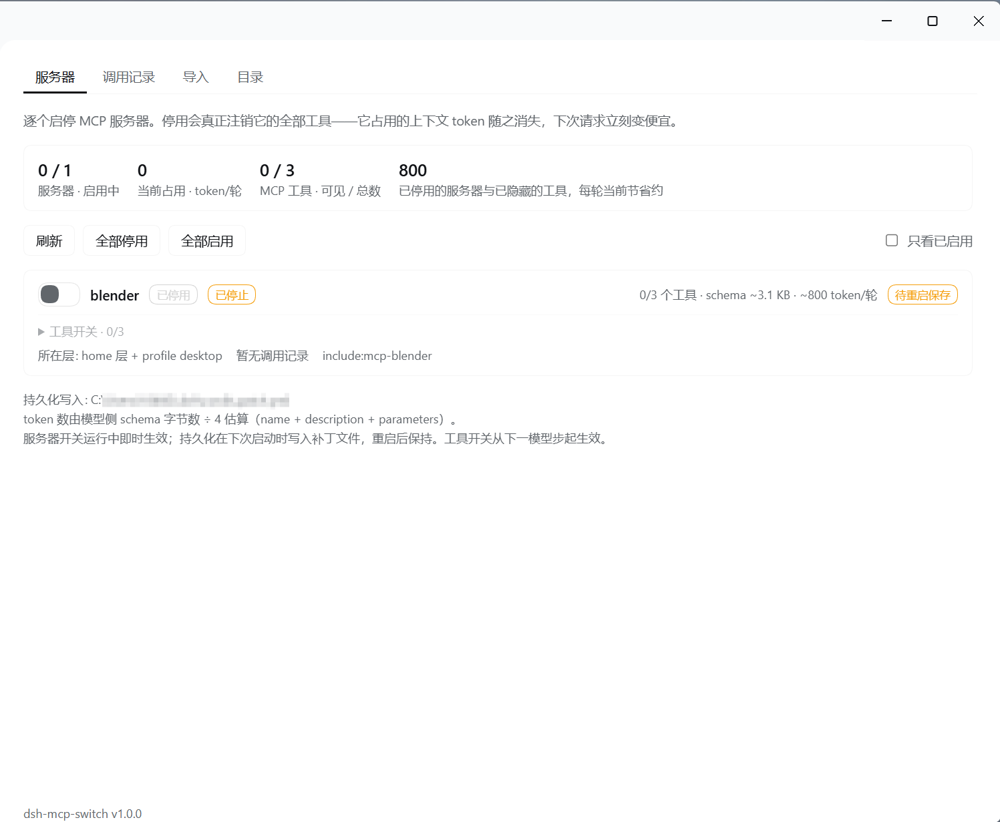
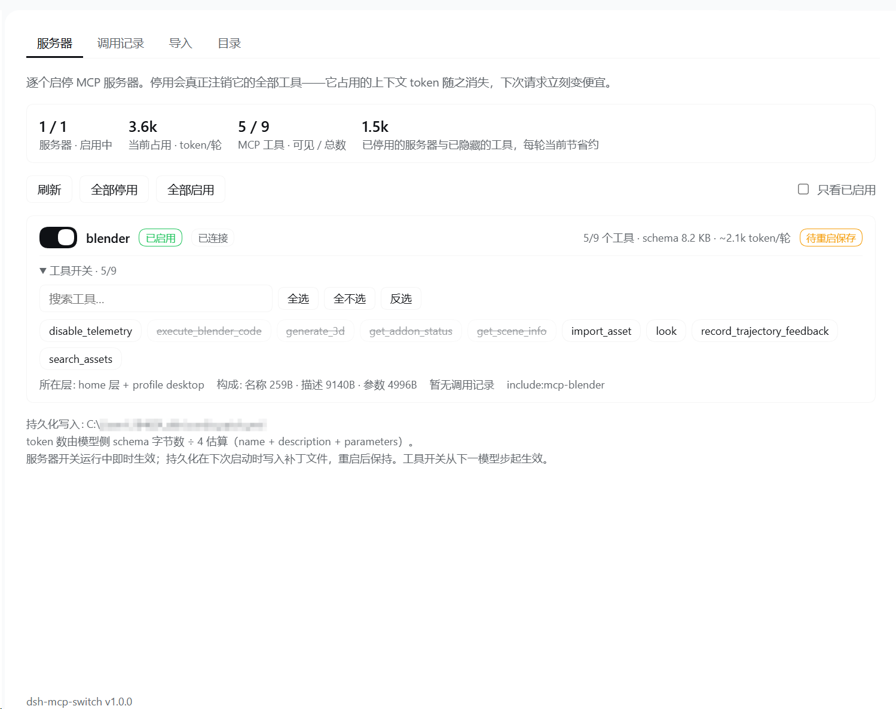

dsh plugin --profile web add github:subeichen1/dsh-mcp-switch

English | [中文简介](#中文简介)

# dsh-mcp-switch — MCP switchboard for DSH（DSH 的 MCP 开关面板）

---

## What it is

An MCP server in DSH is a **resident cost**. Once connected, the schema of every one
of its tools — name, description, parameters — enters the **stable prefix of every
single request**. The heavier the server, the more it costs:

| Server | Tools | Model-facing schema bytes | Per turn |
|---|---|---|---|
| `rea` (measured on this machine) | 207 | 766,054 B | **~191K tokens** |

That is not an estimate; it is what the panel reads back from `ctx.tools.schemas()`.
Inside a 320K-token prefix, one server owns three fifths of it — which decides whether
a request can carry anything else at all.

The plugin adds one panel that does seven things:

1. **Show** how many tools each MCP server has registered, how many bytes that is,
   and what it costs in tokens.
2. **Toggle** it — disabling genuinely **unregisters** all of its tools and saves the
   **full** amount, rather than hiding them.
3. **Remember** the choice by writing an override row into `$DSH_HOME/cordis.patch.yml`,
   so it survives a restart.
4. **Record** which servers are actually called, how slowly, and how often they fail —
   see *Call log*.
5. **Import** servers already configured in another MCP client — see *Import from
   another client*.
6. **Install** a server from the official catalog straight into the patch file — see
   *Catalog search and install*.
7. **Narrow to individual tools** — keep the server, switch off a few of its tools — see
   *Tool granularity*.

The panel lives in **Settings → MCP Switch** by default, and can move to the left
sidebar instead — see *Panel entry*.

## 中文简介

DSH 的 MCP 开关面板：可以随时关闭整个 MCP 服务器，也可以只隐藏单个工具，并直观看到每一项选择在上下文中消耗多少 token。服务器开关会真正注销工具，立即省下完整 schema；工具开关在下一步模型调用生效，无需重连。面板默认位于“设置 → MCP Switch”，也可以移到左侧栏。欢迎在 GitHub Issues 提交建议与反馈。

## Features

- **Server switches** — turn a whole MCP server off; its tools leave the model's tool list and the full schema cost drops to zero.
- **Tool-granularity switches** — keep a server connected and hide only the tools you do not want; the change takes effect on the next model step.
- **Token visualization** — schema bytes and estimated tokens per turn for every server and every tool, read from what DSH actually registers.

## Usage

1. Install the plugin with the command at the top of this page, then hard-refresh the browser if the client half is not visible.
2. Open **Settings → MCP Switch**. To move the panel to the left sidebar, open **Settings → Plugins → dsh-mcp-switch → Panel entry**.
3. Toggle a server to unregister it completely, or expand it and toggle individual tools.
4. Server switches are written to `$DSH_HOME/cordis.patch.yml` and survive restarts; tool switches are written to `$DSH_HOME/dsh-mcp-switch/state.json` and are re-applied when DSH starts.

## Screenshots




## Panel entry

One page, two seats: **a page inside Settings**, or **a row of icons in the left
sidebar**. The default is the settings page, because an upgrade should never move a
panel nobody asked to move.

To move it, open **Settings → Plugins → dsh-mcp-switch**; the "Panel entry" card there
changes it at any time:

| Choice | The panel appears as |
|---|---|
| Sidebar only | one icon row in the left sidebar (the settings section unregisters) |
| Settings only | one page inside Settings (the sidebar row unregisters) |

**Only one seat exists at a time** — the seat being unregistered is deselected first, so
no icon is left pointing at nothing. The preference lives in
`$DSH_HOME/dsh-mcp-switch/state.json` and is **never** written into
`cordis.patch.yml`: a patch states composition, no composition reads this value, and
putting it there would wake the patch watcher to replay composition on every click.

## What it is not

- **Not** fake saving. "Hidden but still registered" is not a mode here — see
  *Disabling really saves* below.
- **Not** a connector panel. Connector panels enumerate only the connections **they**
  created. This one enumerates loader entries, so it sees **every
  MCP row in every layer**, whatever put it there.
- **Not** a runtime mounter that owns what it installs. Every server it adds is
  **written into the patch file**, so `git diff` shows it, uninstalling removes it
  cleanly, and a restart keeps it.
- **No build step and no dependencies.** Plain JS: `index.js` + `client.js` + `lib/`.

## Do you need it

Only if you have MCP servers that are **numerous enough or heavy enough to be worth
switching**. The test:

- Open the panel and look at the *per turn* column. **A single light server** (a few
  dozen tools, tens of kilobytes) **does not justify it** — the tokens you save are
  worth less than the cost of one more plugin.
- **Heavy servers pay off** (hundreds of tools, hundreds of kilobytes). REA, an MCP
  that describes itself exhaustively, is the archetype.
- If you never switch MCP combinations between projects, commenting the row out of the
  patch is simpler than installing anything.

## Disabling really saves — the mechanism and the evidence

Whether disabling an MCP entry actually saves tokens has exactly one test: **do the
tools really disappear from the registry?**

The chain below was verified line by line in the DSH sources and then measured live:

```
loader: Entry#update({disabled:true})
  → the entry's fiber is disposed
    → @deepseek-ai/dsh-mcp-client's ctx.effect cleanup runs
      → the stdio transport is closed
      → and the disposer it registered per tool is called
        → the ctx.tools.register registration is withdrawn
```

The load-bearing fact: `dsh-mcp-client` has **no lazy registration path**. There is one
route only — `syncTools` → `listTools({cacheMode:"refresh"})` → `ctx.tools.register`
per tool. So "disabled" necessarily means "unregistered". There is no intermediate state
where the entry is off but the schemas are still around.
Writes use entry-level `Entry#update` only, **never** `EntryTree.update` — the latter
flattens every patch into `cordis.yml` and destroys the patch layer.

Measured on this machine (desktop profile, server `rea`):

| Step | Result |
|---|---|
| Before | `enabled: true`, `fiberPhase: active`, `tools: 207`, `estTokens: 191514` |
| After disable | `enabled: false`, `fiberPhase: null` (fiber disposed), **`tools: 0`**, `estTokens: 0` |
| After re-enable | `enabled: true`, `fiberPhase: active`, `tools: 207`, `estTokens: 191514` |

`tools: 0` is the point: it comes from `ctx.tools.schemas()`, the table of what is
**actually registered right now**. It is not this plugin's own accounting — it is the
tool service's answer.

> Consequently this plugin **does not implement a "hide but keep registered" mode**.
> Such a mode saves nothing while making you believe it did — this repository refuses
> to ship that (see `DECISION.md`).

## Tool granularity

Keep the server, switch off a few of its tools. This is **not the same mechanism** as the
server switch, and the difference is worth stating plainly:

| | Server switch | Tool switch |
|---|---|---|
| Written to | an override row in `$DSH_HOME/cordis.patch.yml` | `$DSH_HOME/dsh-mcp-switch/state.json` |
| Connection | closed: the fiber is disposed and every tool unregisters | kept: the tools stay registered, just invisible to that agent |
| Takes effect | after the write, replayed by the patch watcher | on the next model step |
| What it saves | the full schema bytes, plus a connection | only those tools' schema bytes |
| After a restart | applies by itself (declarative) | re-applied by the plugin at startup |

The mechanism is `ctx.tools.restrict({deny})`: a **scope-local** mask, not an
unregistration. DSH refuses a context-global restriction outright when there is no
`agent.ctx` ("a context-global restriction would mask every agent"), so the plugin
applies it per agent and again on `agent/created` — a newly opened session is never
missed.

Three consequences follow:

1. Re-enabling one tool **deletes a single deny entry**: no reconnect, no `tools/list`,
   no re-registration, no patch write.
2. The tool list does not go blank when a server is switched off: the panel greys out the
   cache from the last connection (`knownTools`) and labels it as cached. Those numbers
   carry a `~` prefix, because they are what it used to cost, not what it costs now.
3. "Saves about" subtracts the currently visible cost from the cost of **all** tools,
   taking the baseline from the last connection (`baselineOf`), so switching a server off
   entirely never reads as "saves 0".

In one line: **the server switch saves connections, the tool switch saves context.** Only
switching both saves both.

## Why the HOME layer

DSH composes patches in this order:

```
bundle  →  profile cordis.patch.yml  →  $DSH_HOME/cordis.patch.yml  →  overlays
```

**The HOME layer outranks the per-profile layer.** MCP rows are typically split across
both (REA, for instance, lives in HOME). Write the override into the profile and the
HOME row shadows it — you get a panel that changed something and had no effect.

So the override goes to **`$DSH_HOME/cordis.patch.yml`** (honouring the `DSH_HOME`
environment variable, defaulting to `~/.dsh/cordis.patch.yml`). The panel also lists
**every candidate layer** it checked and whether each one exists.

## Never edit your row — append an override row instead

The panel **never rewrites** the MCP row it finds. That row normally sits inside an
`insert:` list written by the official installer.

What it does instead is append a separate override row:

```yaml
- insert:
    - id: rea-mcp
      name: "@deepseek-ai/dsh-mcp-client"
      config:
        serverName: rea
        # ...

- id: rea-mcp          # ← the only line this plugin added
  disabled: true
```

That works because DSH's built-in patch applier, `applyEntryPatches`, has three
properties:

1. Inserted entries are **indexed as they are added**, so a *later* patch can target an
   *earlier* insert → the override **must come after** the insert, which
   `upsertDisabled()` guarantees;
2. A patch that declares **no `name` skips the name assertion** → the override needs
   only `id` + `disabled`;
3. Overrides apply **key by key** → `disabled` cannot disturb `config`, so your server
   configuration is untouchable.

All three are pinned in `test/patch-contract.test.mjs`, which reimplements that
semantics independently and then asserts the YAML this plugin emits satisfies it.
**That test is a canary, not a leftover.**

The write is **line-wise**: one top-level override row per id, ever; the `disabled:`
line is rewritten in place; nothing is reordered, the file is never rewritten wholesale,
rows inside an `insert:` list are never touched, and CRLF-vs-LF plus the trailing newline
are preserved. **If the file is already in the target state, not one byte changes.**

## Call log

The panel's second tab records **what was actually used**: which MCP tools were called,
how many times, how slowly, and how often they failed.

The data comes from the host's `session/event` stream — `tool/call` and `tool/result`,
paired by `callId`. Only `mcp__<server>__<tool>` and `skill` calls are recorded;
native `read` / `bash` are not, or the log would drown in ordinary work.

| Field | Meaning |
|---|---|
| Today / total | dates are cut in the **local time zone**, not UTC |
| Success rate | only **settled** calls count; running ones stay out of the denominator |
| Average time | same rule — a call that has not settled has no duration to average |
| Retention | 7 days, at most 20 000 lines (`$DSH_HOME/dsh-mcp-switch/calls.jsonl`) |

Each record is written **only when it settles**. Writing a "running" line too and
merging on read looks cheaper, but a process killed between the two writes leaves an
orphan row forever marked *running* — a call that appears to have been running for a
week. This plugin does not do that.

## Import from another client

Servers already configured in another MCP client can be moved into DSH in one click.
Scanning is **whitelist-based**: exactly the ten paths below, **never recursive**.

```
%APPDATA%/Claude/claude_desktop_config.json   Claude Desktop
~/.claude.json                                Claude Code
~/.claude/settings.json                       Claude Code
%APPDATA%/Code/User/mcp.json                  VS Code
%APPDATA%/Code - Insiders/User/mcp.json       VS Code Insiders
~/.cursor/mcp.json                            Cursor
%APPDATA%/Windsurf/User/mcp_config.json       Windsurf
~/.codeium/windsurf/mcp_config.json           Windsurf
~/.gemini/settings.json                       Gemini CLI
~/.codex/config.toml                          Codex CLI
```

Three JSON schemas are recognised (`mcpServers` / `servers` / `mcp.servers`), plus
Codex's `[mcp_servers.<name>]` TOML section (a minimal extractor, so no TOML library
is pulled in). `sse` transport is **not importable** — `dsh-mcp-client` does not
support it, and the panel says so instead of pretending otherwise.

## Catalog search and install

Search hits the official MCP registry (`registry.modelcontextprotocol.io`), because of
the other two sources one measured a 500 and the other is just links inside a README.

Opening the Catalog tab loads the first page straight away — you do not have to think
of a keyword first. The registry returns one row per version, so the same server shows
up two or three times; entries are **collapsed by name, newest version kept**. "Next
page" **appends** to what you already see instead of replacing it.

Installing means **appending a whole `- insert:` block** to
`$DSH_HOME/cordis.patch.yml`. No runtime state is kept elsewhere: the file is written
and DSH's HMR — which is already watching it — picks it up.

| Action | What lands where |
|---|---|
| Install | one more `- insert:` block in the patch file; the live tree mounts it |
| Remove | only the block this plugin wrote; rows the host wrote are byte-identical |
| Roll back | every write is backed up first; `backupPath` points at it |

Before installing, the spec is **validated**: `serverName` must match
`/^[A-Za-z0-9_-]{1,32}$/` (`dsh-mcp-client`'s own rule), and a duplicate id is
**refused rather than overwritten** — overwriting would silently rewrite a server
that is currently running.

## Safety

**No backup is the weakest link.** One bad edit to a shared patch file can break every
profile, so this plugin backs it up before every write.

- **Backup before write.** Before each write the **original bytes** are saved as
  `cordis.patch.yml.backup-<ISO timestamp>-<nn>` in the same directory, and the response
  reports `backupPath`. The sequence suffix is not decoration: the timestamp has only
  millisecond resolution, so a second write in the same millisecond used to **overwrite**
  the first backup — CI on Linux really did lose four copies that way.
- **Automatic pruning.** Only the newest **10** are kept; older ones are dropped by
  filename order.
- **A failed backup does not block.** Backups are best-effort. If one genuinely fails,
  the toggle still takes effect and the response carries `backupError` — it **never
  pretends the backup succeeded**.
- **Live first, persist second.** The runtime change happens first (taking effect
  immediately), then the file is written. If persistence fails, the response reports
  `persisted: false` plus `persistError`: the runtime state is real and the on-disk
  state is not, and the two are reported separately.
- **Nothing is ever thrown across the API.** Every path returns JSON.
- **Locked entries.** `include`, `cordis:include`, `dsh-mcp-switch` are always 403.
- **1 MB request-body cap.**
- **Only the switch, and only the rows this plugin installed.** Toggling touches
  `disabled:` alone; install and remove touch the `- insert:` block this plugin
  appended and its matching top-level override. A server definition written elsewhere
  is never modified, and `cordis.yml` is never touched.

To roll back: copy the file that `backupPath` points at back over `cordis.patch.yml`.

## Install

```bash
# from GitHub (web profile — the profile this GUI uses)
dsh plugin --profile web add github:subeichen1/dsh-mcp-switch

# or from a local directory (use this while developing; re-run add after each change)
dsh plugin --profile desktop add "<absolute path to this directory>"
```

- The plugin row id is **`mcp-switch`**, not the package name — the short id is what
  `cordis.patch.yml` inserts.
- **The client half loads cold.** After installing, and after changing `client.js`,
  **hard-refresh** the page. The host's HMR watches **only its own** patch files and
  does **not** watch sources inside this plugin's directory; changing `index.js` or
  `client.js` needs another `add` before it is projected into the profile.
- Host route: `GET|POST http://127.0.0.1:<port>/mcp-switch/api`.

## Tests

```bash
npm test
```

```
test/unit.test.mjs                 pure functions (every upsertDisabled branch, CRLF, quoted ids)
test/patch-contract.test.mjs       emitted YAML must satisfy real DSH patch semantics (canary)
test/patch.test.mjs                install/remove row editing: quoting, indentation, three delete guards
test/calls.test.mjs                call log: classification, pairing, and the counting rules
test/scan.test.mjs                 config import: three schemas, TOML, the whitelist privacy boundary
test/catalog.test.mjs              catalog search: package choice, spec generation, id normalization
test/write-path.test.mjs           write-path contract: backups, idempotence, no fake success
test/tool-state.test.mjs           tool-granularity state: versioned schema, atomic writes, corrupt fallback
test/known-tools.test.mjs          known-tool cache: complete snapshots only, survives disconnects
test/package-contract.test.mjs     version consistency, files whitelist, no runtime @deepseek-ai dep
test/docs-parity.test.mjs          zh/en README section parity, bilingual release-note structure
test/release-consistency.test.mjs  every version has a release note
test/panel-entry.test.mjs          panel seats, state-file round trip, slot register/unregister, scrolling owner
test/servers-view.test.mjs        servers view: pending rows, per-server call counts
test/catalog-view.test.mjs        catalog view: loads on open, paging appends, search replaces
```

Zero dependencies, using Node's built-in `node:test`.

## HTTP API

`GET /mcp-switch/api` → a snapshot:

```json
{
  "ok": true,
  "servers": [{
    "entryId": "include:rea-mcp",
    "rawId": "rea-mcp",
    "serverName": "rea",
    "enabled": true,
    "fiberPhase": "active",
    "toolCount": 207,
    "schemaBytes": 766054,
    "estTokens": 191514,
    "breakdown": { "nameBytes": 6148, "descriptionBytes": 92265, "parameterBytes": 667641 },
    "tools": [{ "name": "mcp__rea__search", "toolName": "search", "enabled": true,
                "schemaBytes": 4096, "estTokens": 1024 }],
    "visibleToolCount": 207, "hiddenToolCount": 0,
    "visibleBytes": 766054, "visibleEstTokens": 191514,
    "knownTools": [], "knownToolCount": 0, "knownSchemaBytes": 0, "knownEstTokens": 0,
    "pending": null,
    "layer": "home",
    "inFile": true,
    "calls": { "calls": 42, "failed": 1, "avgMs": 310 }
  }],
  "orphaned": [],
  "totals": { "servers": 1, "enabled": 1, "disabled": 0, "mcpToolCount": 207,
              "mcpSchemaBytes": 766054, "mcpEstTokens": 191514,
              "activeEstTokens": 191514, "visibleToolCount": 207, "hiddenToolCount": 0,
              "visibleEstTokens": 191514,
              "baselineToolCount": 207, "baselineEstTokens": 191514, "savingsTokens": 0,
              "bytesPerToken": 4, "calls": 42, "callsToday": 5, "okRate": 97.6 },
  "patchPath": "C:\\Users\\<you>\\.dsh\\cordis.patch.yml",
  "callsPath": "<DSH_HOME>/dsh-mcp-switch/calls.jsonl",
  "layersReadable": true,
  "panelEntry": "settings",
  "panelEntryFile": "<DSH_HOME>/dsh-mcp-switch/state.json",
  "stateFile": "<DSH_HOME>/dsh-mcp-switch/state.json",
  "stateError": null,
  "stateMissing": false,
  "stateBackupUsed": null,
  "stateBrokenPath": null,
  "stateMoveError": null,
  "stateDamage": null
}
```

(`panelEntryError` appears only when the state file exists but cannot be read.)
(`stateDamage` is the damage this process remembers: the file watcher usually reads the broken
file first and moves it aside, so by the time the panel reads it everything looks fine — this is
the only trace left.)
(`orphaned` lists rows the patch file has but the live tree never mounted.)
(`known*` is the tool cache from the last connection: a disabled server's live schema is
empty, so only the cache remembers what it cost.)
(`baseline*` is the cost with nothing switched off; `savingsTokens = baselineEstTokens −
visibleEstTokens`.)

Add `?view=` for three more views:

| view | Returns |
|---|---|
| (default) | the server snapshot: per-row cost, call count, still in the patch file |
| `calls` | the latest 200 call records, the statistics, and the log path |
| `scan` | the whitelist scan, each entry carrying an installable `suggested` |
| `catalog&q=&cursor=` | official catalog results, each carrying a `suggested` |

`POST /mcp-switch/api`, one of seven shapes:

```json
{ "entryId": "include:rea-mcp", "disabled": true }
{ "action": "disable-all" }
{ "action": "set-panel-entry", "entry": "sidebar" }
{ "action": "set-tool", "serverName": "rea", "toolName": "search", "enabled": false }
{ "action": "install-server", "spec": { "id": "mcp-fetch", "serverName": "fetch", "transport": "stdio", "command": "uvx", "args": ["mcp-server-fetch"] } }
{ "action": "remove-server", "rawId": "mcp-fetch" }
{ "action": "clear-calls" }
```

Server-toggle response: `{ ok, entryId, rawId, serverName, disabled, fiberPhase, pending,
statePersisted, stateFile, patchDeferred }`.
Tool-toggle response: `{ ok, action: "set-tool", serverName, toolName, enabled, persisted,
persistError?, statePersisted, stateError?, stateFile, backupPath?, backupError?,
restrictionError? }`; a disabled server returns **409** without changing state.
A failed state write is still **200** with `persisted: false` — the switch took effect in
this session, it just will not survive a restart.

Panel-entry response: `{ ok, action: "set-panel-entry", panelEntry, panelEntryFile }`.
An `entry` that is neither `sidebar` nor `settings` is **400** — refused rather than
substituted for a valid one; a failed write is **500**, leaving the state file as it was.

Install response: `{ ok, action: "install-server", id, serverName, patchPath, backupPath? }`.
The loader is **not** called — the written patch file is handed to DSH's HMR. An id that
already exists is **409**; an invalid spec is **400**. Remove response:
`{ ok, action: "remove-server", rawId, removed, patchPath, backupPath? }`; not found is
**404**, a locked entry is **403**.

| Status | Meaning |
|---|---|
| 400 | malformed body / `disabled` is not a boolean / target is not an MCP row / invalid spec |
| 403 | empty `entryId` / entry is locked |
| 404 | unknown entry / the id to remove is not in the patch |
| 405 | method not allowed |
| 409 | the id being installed already exists (refused rather than overwriting a live server) |
| 500 | the loader threw / the write failed |
| 502 | the catalog service is unreachable |
| 503 | the loader service is unavailable |

## Two honest caveats

**One: `estTokens` is a division, not a tokenizer.** It is `bytes / 4`. Mixed scripts,
JSON structure, and repeated fields all push it away from the true value, typically by
±15%. Its job is **ranking and order of magnitude** — *is this server worth keeping
resident* — not *exactly how many tokens did this turn cost*. Trust the bill for
absolutes.

**Two: it measures the model-facing projection, not the raw MCP payload.** The plugin
counts only `name` + `description` + `JSON.stringify(parameters)`. If an MCP tool
advertises an `outputSchema`, **it does not enter the model context** (DSH forwards only
`parameters`), so this plugin **does not count it**. That is exactly why roughly 73% of
REA's raw 3.0 MB payload is excluded — the panel's 785 KB is the part that **actually
enters the context**, far smaller than the raw `tools/list`, and far more honest.

## Feedback

Found a bug or have a suggestion? Please open an issue at
https://github.com/subeichen1/dsh-mcp-switch/issues.

## Layout

```
index.js          host half: route + enumeration + cost accounting + persist (line-wise upsert + backups)
client.js         browser half: four views (hand-written ModuleLoader CJS closure, no build step)
lib/patch.js      install/remove: validating, generating, and precisely deleting patch rows
lib/calls.js      call log: classification, pairing, counting rules, trimming
lib/scan.js       config import: ten whitelisted paths, three JSON schemas, minimal TOML
lib/catalog.js    official catalog search: package choice and spec generation
cordis.patch.yml  inserts the plugin row mcp-switch
locale/           en.json / zh.json — title and description in the plugin list
icon.svg          plugin icon
AGENTS.md         the maintenance contract (read this before changing the repo)
DECISION.md       why an override row, why no "fake saving" mode
DESIGN.md         tool granularity: state schema, mechanism choice, failure modes
SECURITY.md       security model and threat boundaries (English)
SECURITY.zh.md    the same, in Chinese
docs/             release notes
test/            zero-dependency tests (node:test)
```

## License

MIT. See `LICENSE` for the full license text.
